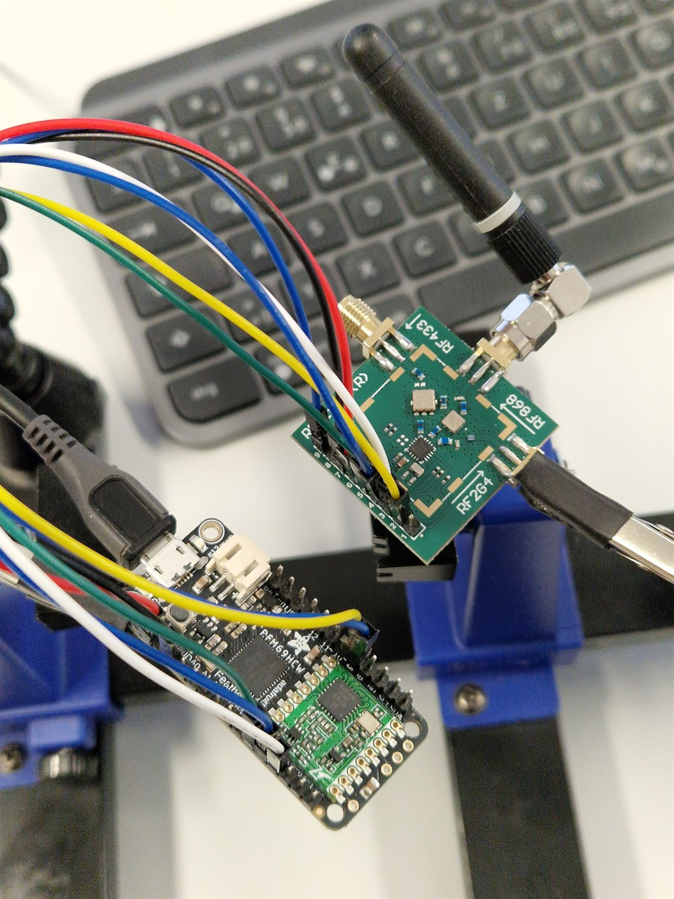

# FH101TRX – Transmit/receive link test on a single board

Combined sketch that puts the wake-up telegram transmitter and the FH101RF
receiver on **one** board, so the radio link can be evaluated without a second
device:

- **TX:** the on-board **RFM69HCW** of the Adafruit Feather M0 sends an FH101RF
  wake-up telegram every `TX_REPEAT_MS` in OOK packet mode (driver from the
  example `WurxTelegramSendRfm69`).
- **RX:** the soldered-on **FH101RFBOB** breakout listens with the 868 MHz preset
  `wurx_conf_868_1k_32k_idm2slow_allbranch_dout1` of the driver library (as in the
  sketch `FH101RFRX`).

Every received event is printed on the serial console with IRQ status, ID type,
band, counter value and payload, together with a link statistic
`received / sent`.

The sketch is **complete and ready to use**: all required driver sources are in
the folder, no additional libraries have to be installed and no code has to be
added. Just wire it up, select the board, upload - after the reset the link test
reports on the serial console right away.

## Measurement result

On the Feather M0 RFM69HCW with FH101RFBOB:

```
link: 14 of 14 telegrams received
rx #N: IRQ_STATUS 0x20, ID individual, band 868, payload AF FE 00 00 00 00  -> payload OK
```

One event every 3062 ms, no dropouts. Important: the Feather board has **no
antenna on the RFM69** – see section “Transmit power”.

## Files

| File | Content |
|---|---|
| `FH101TRX.ino` | Sketch: configuration, transmitter, receiver, link statistic |
| `fh101rf_platform.cpp` | Driver hooks `wurx_write_reg()`, `wurx_read_reg()`, `wurx_reset_register()` through the Arduino hardware SPI |
| `fh101rf_platform.h` | Includes `wurx.h` with C linkage (required because `.ino` is C++) |
| `fh101rf_config.h` | Pins and SPI clock of the FH101RFBOB |
| `wurx.c` / `wurx.h` | Unmodified FH101RF driver library from the repository |
| `wurx_telegram.c` / `.h` | Telegram generator (from `FH101RFTX/src/`) |
| `rfm69_ook.cpp` / `.h` | OOK packet mode driver for the RFM69HCW |

## Wiring

Both radio chips are on the **same SPI bus**:

| Signal | RFM69HCW (on-board) | FH101RFBOB |
|---|---|---|
| CS | D8 | D10 (`CS_N`) |
| IRQ / GPO | D3 (DIO0) | D9 (`GPO1`) |
| RESET | D4 (active HIGH) | not wired |
| SCK | D24 | D24 |
| MOSI | D23 | D23 |
| MISO | D22 | D22 |



*The setup from the measurement result: FH101RFBOB with its 868 MHz SMA antenna
(top), connected to the Feather M0 RFM69HCW (bottom) via supply and SPI. The
antenna connector of the on-board RFM69 is empty.*

### Rules for the shared bus

These three points are not a matter of style, they are the precondition for the
setup to work at all:

1. **Exactly one chip may be selected at a time.** `spiBusIdle()` pulls both CS
   HIGH and wraps every radio access in the sketch.
2. **The direction bits are opposite:** on the RFM69 bit 7 = 1 means *write*, on
   the FH101RF bit 7 = 1 means *read*. An accidental access to the wrong chip is
   therefore a **valid command** there and is executed instead of ignored.
3. **`rfm69_ook_send()` keeps one SPI transaction open for the whole telegram
   (~63 ms).** The FH101RF must not be touched inside that window. The sketch
   therefore reads the latched IRQ **before** the next transmission.

In addition the CS of the FH101RF has to be firmly HIGH before the first SPI
traffic: `setup()` sets both CS before any driver initialises the bus. The
FH101RF has no wired reset (`RESET_N` open) and cannot recover from a foreign
register access by itself.

## Transmit power

The power is written to `RegPaLevel` at runtime through
`rfm69_ook_set_power_dbm()` and read back. A `#define` in the `.ino` is **not**
sufficient, because `RFM69_TX_POWER_DBM` is compiled in as a constant inside
`rfm69_ook.cpp`.

> **No antenna on the RFM69.** The Feather board is shipped without an antenna –
> neither a wire at the ANT pad nor a u.FL module is fitted. The transmitter
> therefore radiates only a few centimetres; a significant radio range is
> **not** possible in this state. **Fitting an antenna is strongly recommended**
> before the range of the receiver is judged.

A power sweep (one step per telegram) shows how much link budget the missing
antenna costs:

| Power | `RegPaLevel` | Reception |
|---|---|---|
| −18 dBm | `0x40` | ✗ |
| −10 dBm | `0x48` | ✗ |
| −4 dBm | `0x4E` | ✗ |
| 0 dBm | `0x52` | ✓ |
| 5 dBm | `0x57` | ✓ |
| 10 dBm | `0x5C` | ✓ |
| 13 dBm | `0x5F` | ✓ |

The receiver itself is fine: the same setup hears an external device at 15 cm
distance at full sensitivity (17 of 17 telegrams). The missing ~18 dB are the
antenna, which is why `TX_POWER_DBM` is set to **+13 dBm**. Once an antenna is
fitted – a quarter-wave wire at the ANT pad (≈ 8.6 cm at 868 MHz, ≈ 8.2 cm at
915 MHz) or a u.FL antenna module – a realistic value such as −10 dBm is
sufficient again.

## Intermediate frequency

`lo_target_868` is the frequency of the free-running oscillator, **not** the
carrier frequency. An 868.4 MHz carrier lands at |868.4 − fLO| MHz:

- preset 920 MHz → **52 MHz** IF (datasheet recommends 30…50 MHz, optimum 40)
- 908 MHz → 40 MHz IF

The change to 908 MHz was measured and was **worse**: the first reception then
needed 10 dBm instead of 0 dBm. The 30…50 MHz figure is a recommendation, not a
hard limit; the correlator copes with the wider IF. The preset therefore stays
unchanged.

## Configuration

All switches are at the top of `FH101TRX.ino` and can also be set through a
compiler define:

| Define | Default | Meaning |
|---|---|---|
| `TX_FREQ_HZ` | `868400000UL` | Carrier frequency |
| `TX_REPEAT_MS` | `3000UL` | Transmit interval |
| `TX_ID` | `WURX_TG_DEFAULT_ID` | Wake-up ID, has to match the receiver ID |
| `TX_POWER_DBM` | `13` | Transmit power, −18 … +13 dBm |
| `TX_SEND_ENABLE` | `1` | `1` = transmit, `0` = receive only |
| `RX_LISTEN_MS` | `10000UL` | Length of a receive window (marker in the log only) |

### Receive only (`TX_SEND_ENABLE 0`)

The RFM69 is initialised and set to its power, but never keyed. This allows an
**external** transmitter to be checked without its own carrier sitting on the
receiver. Reception keeps running continuously; `RX_LISTEN_MS` only marks a
window in the log so that a late-keyed telegram is not lost.

## Build and flash

```bash
arduino-cli compile --fqbn adafruit:samd:adafruit_feather_m0 FH101TRX
arduino-cli upload  --fqbn adafruit:samd:adafruit_feather_m0 -p COM10 FH101TRX
```

`arduino-cli upload` accepts **no** `--build-property`; switches have to be set
in the sketch.

## Serial output (115200 baud)

```
==================================================
 FH101TRX - FH101RF wake-up transceiver test
==================================================
tx: RFM69HCW, 868399963 Hz, 33092 chip/s, PA_BOOST
tx: power 13 dBm, RegPaLevel 0x5F (verified)
tx: ID 0x7DA8, payload AF FE, every 3000 ms
tx: mode sending
rx: IC version 0x41
rx: wurx_init() with the 868 MHz preset
    (xtal, LO and offset calibration)
rx: LO target 920 MHz -> IF 52 MHz
rx: init 111 ms, XTAL_GOOD 0x1, CALIB_STATUS 0x0, OK
rx: ACTUAL_BANDSELECT 0x2 (868 MHz active)
rx: BAND_BRANCH_CTRL 0x27, IRQ_SELECT 0x20, ID 0x7DA8

ready: sending every 3000 ms, listening for wake-up events

tx #1: ID 0x7DA8, 2 payload byte(s), 260 byte(s), 62855 us, 13 dBm
rx #1 after 1614 ms: IRQ_STATUS 0x20, ID individual, band 868, counter 51449358, payload AF FE 00 00 00 00  -> payload OK
   link: 1 of 1 telegrams received
```

## Notes

- **The FIFO returns its whole depth.** A received telegram with two payload
  bytes appears as `AF FE 00 00 00 00`. Therefore only the leading
  `TX_PAYLOAD_SIZE` bytes are compared; a check on `fifo_count == 2` can never
  match.
- The counter (`counter`) increments by 100389 per telegram – it counts the
  32.768 kHz ticks of the receiver, not the telegrams.
- The board does not recover by itself in an error case; a hang has so far only
  been cleared by a manual reset.
- Sending a telegram blocks for ~63 ms. That is unproblematic for a link test,
  but not for an application with short reaction times.

## License

MIT, see `LICENSE` in the repository.
