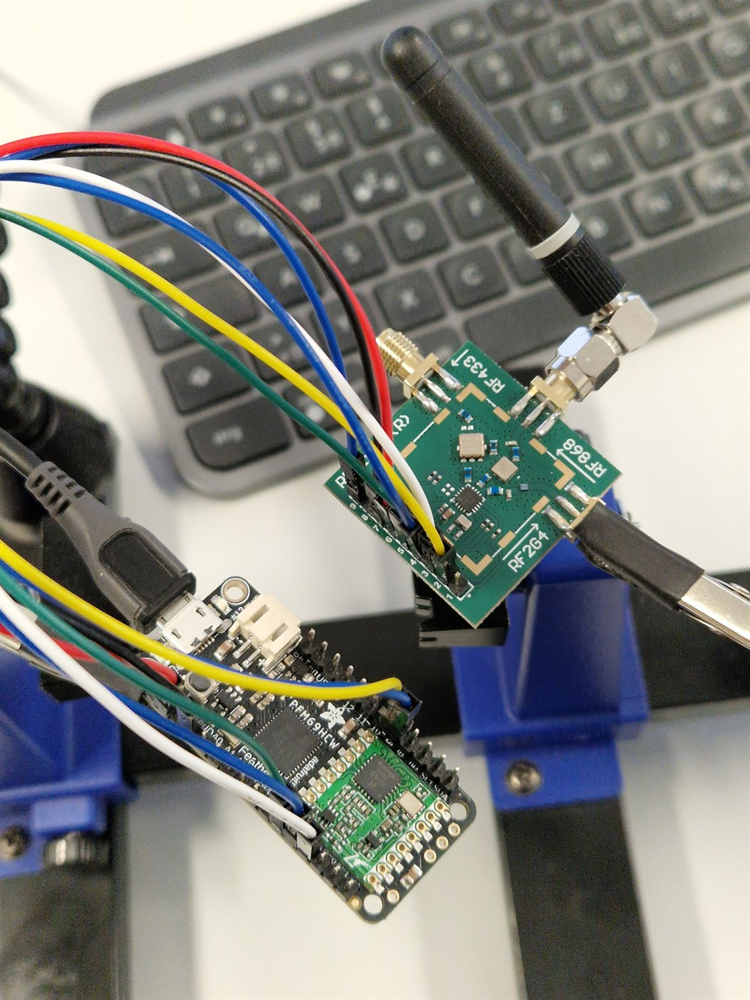

# FH101RF Application Example

[](#hardware)
[](#hardware)
[](#repository-layout)
[](#signal-format)
[](LICENSE)

A complete, ready-to-use hardware and software example for the **RFicient® FH101RF**
wake-up receiver. The project runs on an **Adafruit Feather M0 RFM69HCW** and an
**FH101RFBOB** breakout board. It lets an end user configure the FH101RF and
generate a matching RF signal in FH101RF format, so a wake-up link can be built
and tested without any additional tooling.

---

## What this project does

| Function | Description |
|---|---|
| Configure the FH101RF | Band, branch, FDD, IDM, data rates, LO target, IRQ source and clock mode are set through the `wurx` driver |
| Calibrate the receiver | Crystal start-up, LO calibration and comparator offset calibration, each with a bounded timeout and a status flag |
| Generate the RF signal | The RFM69HCW transmits an OOK telegram in FH101RF format (31-bit CodeA preamble at the low data rate, CodeB data at the high data rate, ID block) |
| Receive and evaluate | The FH101RF reports an IRQ, the driver reads correlator state, correlator value, ID reason and FIFO payload into an event store |
| Store the events | Optional interrupt memory (`WURXIRQSTORE`) keeps up to `MAXLISTENTRIES` events with timestamp, band information and payload |
| Show the result | All state and event data is printed on the Feather serial console |

## Hardware

**Receiver — FH101RFBOB**

- RFicient® FH101RF wake-up receiver, postage-stamp sized board (32 × 32.64 mm)
- RF filtering, matching network and clock generation on board
- Bands 433 / 868 / 2G4 (EU version) or 433 / 915 / 2G4 (nonEU version), selected by the SAW filter
- Antennas on SMA connectors, all control signals on a 0.1 in pin header
- Supply 1.6 V … 3.63 V, SPI up to 10 MHz, 3-wire or 4-wire SPI
- GPO1 / GPO2 are used as the interrupt output to wake up the MCU

**Controller and transmitter — Adafruit Feather M0 RFM69HCW**

- SAMD21 Cortex-M0+, Arduino/PlatformIO compatible
- RFM69HCW transceiver, used in OOK mode as the FH101RF-format signal source
- USB serial console for configuration and event output

### Test setup



*FH101RFBOB with its 868 MHz antenna (top) wired to the Adafruit Feather M0
RFM69HCW (bottom). The antenna connector of the on-board RFM69HCW is empty.*

> **The on-board RFM69HCW has no antenna.** The Feather is shipped without one —
> neither a wire antenna at the ANT pad nor a u.FL module is fitted. The
> transmitter therefore radiates only a few centimetres, so **no significant
> radio range is possible in this state, and fitting an antenna is strongly
> recommended** before the range of the receiver is judged.

Until an antenna is fitted the sketch has to compensate with the maximum output
power (`TX_POWER_DBM 13`); the power sweep in
[`FH101TRX/README.md`](FH101TRX/README.md#transmit-power) shows how much link
budget the missing antenna costs. A quarter-wave wire at the ANT pad (≈ 8.6 cm
for 868 MHz, ≈ 8.2 cm for 915 MHz) or a u.FL antenna module restores a
realistic operating point of about −10 dBm. The receiver in the photo already
has its antenna: the FH101RFBOB has SMA connectors and is operated with the
antenna that matches the fitted SAW filter (Linx `ANT-868-CW-HWR-SMA` for
868 MHz, `ANT-916-CW-HWR-SMA` for 915 MHz).

### EU vs. nonEU: the 868 / 915 MHz signal path

The FH101RF IC has three band paths (433, 868, 2G4). There is **no separate
915 MHz path** - 868 and 915 share the same path, the same matching network and
the same SMA connector. What differs between the two board versions is the
**SAW filter fitted into that shared path**, and that filter decides which of
the two frequencies the board can actually hear:

| Board version | Receiving bands | SAW filter in the 868/915 path | Center frequency |
|---|---|---|---|
| `FH101RFBOB_EU_V1.0` | 433 / 868 / 2G4 | RF360 `B39871B3744H110` | **868.3 MHz** |
| `FH101RFBOB_nonEU_V1.0` | 433 / 915 / 2G4 | RF360 `B39921B3300H110` | **916.5 MHz** |

Both versions use the same 433 MHz filter (RF360 `B39431B3790Z810`, 433.9 MHz)
and the same 2.4 GHz filter (RF360 `B39252B7556P810`, 2478 MHz); only the
868/915 position is populated differently.

Consequences for using the board:

- **868 and 915 are mutually exclusive on one board.** The EU board cannot
  receive 915 MHz and the nonEU board cannot receive 868 MHz - the SAW filter
  in front of the receiver blocks the other frequency. A band that is not on
  the board cannot be enabled by software.
- **The software preset has to match the fitted filter, not the IC.** Both
  versions are configured through the same 868 MHz band path of the IC, so the
  only thing that changes in software is the LO target.
- The nonEU filter is centered at **916.5 MHz**, not 915 MHz. That is why the
  915 preset is named `916` and why `lo_target_868 = 956` fits so well:
  956 − 916.5 = **39.5 MHz** intermediate frequency, essentially the datasheet
  optimum of 40 MHz.
- Sensitivity is the same on both paths: −72 dBm at 868.3 MHz and −72 dBm at
  916.5 MHz.
- The matching antenna for the nonEU board is the Linx `ANT-916-CW-HWR-SMA`
  (EU: `ANT-868-CW-HWR-SMA`).

Source: `FH101RFBOB_en_V1R3.pdf`, sections 1 (Introduction), 4 (Board
structure, Table 3), 5 (operating conditions) and 6 (Ordering information).

## Signal format

The transmitter has to match the receiver configuration, otherwise no wake-up
event is generated:

1. **Low data rate (LDR)** — a 31-bit CodeA sequence is sent as the wake-up
   preamble. The default preset uses 1 kbit/s.
2. **High data rate (HDR)** — after the preamble the receiver switches to the
   high data rate, where CodeA and CodeB chips form the data bits. The default
   preset uses 32 kbit/s.
3. **ID block** — the ID is transmitted after the data block. The default preset
   uses `0x7da8` and `WURX_IDM_INDIVIDUAL`, so only the individual ID is
   detected, no group ID and no broadcast ID.
4. **Modulation** — OOK, MSB first.

The presets in `wurx.c` (`wurx_conf_433_1k_32k_idm2slow_allbranch_dout1` and the
868 / 2G4 variants) contain the matching transmitter settings.

## Wiring

The FH101RFBOB pin header is connected to the Feather. The GPIO levels of the
BOB are defined by its VDD pin, so VDD and the MCU I/O voltage must match.

### Connection diagram

```
   Adafruit Feather M0 RFM69HCW              FH101RFBOB (pin header)
   +---------------------------+            +------------------------+
   |                           |            |                        |
   |  3V3  --------------------+------------+-- 6  VDD   1.6-3.63 V |
   |  GND  --------------------+------------+-- 7  GND               |
   |                           |            |                        |
   |  SCK  (D24) --------------+------------+-- 5  SCLK   max 10 MHz |
   |  MOSI (D23) --------------+------------+-- 4  MOSI              |
   |  MISO (D22) --------------+------------+-- 3  MISO              |
   |  D10  --------------------+------------+-- 2  CS_N              |
   |                           |            |                        |
   |  D9   --------------------+------------+-- 9  GPO1 / IRQ        |
   |  D11  --------------------+------------+-- 1  RESET_N  optional |
   |  D6   --------------------+------------+-- 8  GPO2 / IRQ  opt.  |
   |                           |            |                        |
   +---------------------------+            +------------------------+

   mandatory : VDD, GND, SCLK, MOSI, CS_N, GPO1
   optional  : RESET_N (internal pull-up), MISO (3-wire SPI), GPO2
   reserved  : D3, D4, D8 are used by the on-board RFM69HCW
```

### Pin assignment

| FH101RFBOB pin | Name | Feather M0 | Direction | Note |
|---|---|---|---|---|
| 1 | RESET_N | D11 | MCU → BOB | optional, BOB has an internal pull-up |
| 2 | CS_N | D10 | MCU → BOB | mandatory, SPI slave select |
| 3 | MISO | MISO (D22) | BOB → MCU | 3-wire SPI: shared with MOSI |
| 4 | MOSI | MOSI (D23) | MCU → BOB | mandatory |
| 5 | SCLK | SCK (D24) | MCU → BOB | mandatory, max. 10 MHz |
| 6 | VDD | 3V3 | — | 1.6 V … 3.63 V |
| 7 | GND | GND | — | mandatory |
| 8 | GPO2 | D6 | BOB → MCU | optional, interrupt output, function set by register 0x75 |
| 9 | GPO1 | D9 | BOB → MCU | interrupt output, function set by register 0x75 |

The CS and IRQ pins are configurable in the platform layer, D10 and D9 are the
proposed assignment. Use a pin that supports deep-sleep wake-up if the MCU is
meant to be woken by the receiver. On the Feather M0 RFM69HCW the pins D3, D4
and D8 are occupied by the on-board RFM69HCW (IRQ, reset and chip select), so
they are not available for the FH101RFBOB. All BOB outputs are series connected
through 1 kΩ resistors on the board.

## Repository layout

```
.
├── wurx.c                  FH101RF driver implementation
├── wurx.h                  FH101RF driver API, register map and enums
├── LICENSE                 MIT license
├── FH101RFRX/              Ready-to-use receiver sketch: configures the FH101RF and prints events
├── FH101RFTX/              Transmitter library: generates and sends the wake-up telegram
│   ├── src/                wurx_telegram.c / .h, portable C11
│   └── examples/           Ready-to-use sketches: WurxTelegramDump, WurxTelegramSendRfm69
├── FH101TRX/               Ready-to-use link test: on-board RFM69 sends, FH101RFBOB receives
├── docs/
│   └── test-setup.jpg      Photo of the test setup (FH101RFBOB and Feather M0)
├── FH101RFBOB_en_V1R3.pdf  Breakout board documentation (LZE GmbH)
└── FH101RF_LZE_Datasheet_Revision_1p3b_A_1_1.pdf
```

## Example sketches

All example projects in this repository are **complete, ready-to-use Arduino
sketches**. They compile as they are, contain every driver source they need and
work with nothing but the wiring shown above - no extra libraries to install and
no code to fill in. Open the sketch folder in the Arduino IDE (the folder name
has to match the `.ino` name) or build it with `arduino-cli`, select the board
and upload:

```bash
arduino-cli compile --fqbn adafruit:samd:adafruit_feather_m0 FH101TRX
arduino-cli upload  --fqbn adafruit:samd:adafruit_feather_m0 -p COM10 FH101TRX
```

| Sketch | Board | What it does |
|---|---|---|
| [`FH101TRX`](FH101TRX/README.md) | Feather M0 RFM69HCW + FH101RFBOB | Complete link test on a single board: the on-board RFM69HCW sends the wake-up telegram, the FH101RFBOB receives it. **Start here** - this is the shortest way to see the whole link working. |
| [`FH101RFRX`](FH101RFRX/README.md) | Feather M0 RFM69HCW + FH101RFBOB | Receiver only: configures the FH101RF, prints the init status and reports every wake-up event |
| [`WurxTelegramSendRfm69`](FH101RFTX/examples/WurxTelegramSendRfm69) | Feather M0 RFM69HCW | Transmitter only: sends the wake-up telegram with the on-board RFM69HCW |
| [`WurxTelegramDump`](FH101RFTX/examples/WurxTelegramDump) | any Arduino board | No radio and no FH101RF needed: generates the telegram, decodes it back and prints it as a hexdump |

Every sketch folder carries its own copy of the driver sources it uses, so the
folders are self-contained and can be copied out of the repository on their own.
The only thing to adapt is the pin assignment in `fh101rf_config.h` if the
wiring differs from the one shown above.

The driver is plain C11 without any RTOS dependency. The only platform hooks are
the three weak functions that the application has to provide:

```c
void    wurx_write_reg(uint8_t addr, uint8_t value);
uint8_t wurx_read_reg(uint8_t addr);
void    wurx_reset_register(void);   /* weak, empty default */
```

## Quick start

If you just want to see the link work, use one of the ready-to-use example
sketches above - `FH101TRX` sends and receives on a single board and needs no
code at all. The steps below are what these sketches do internally, for
integrating the driver into your own application.

1. Wire the FH101RFBOB to the Feather as shown above.
2. Implement the SPI hooks `wurx_write_reg()` and `wurx_read_reg()` in the
   platform layer.
3. Select a preset and initialize the receiver:

   ```c
   if(wurx_init(wurx_conf_868_1k_32k_idm2slow_allbranch_dout1))
   {
       /* receiverGood: xtal ok, LO cal done, offset cal done */
   }
   ```

4. Enable the interrupt memory if the events have to be kept:

   ```
   build_flags = -DWURXIRQSTORE
   ```

5. Handle the interrupt. The ISR writes the event data directly into the entry
   the caller passes in:

   ```c
   void irq_handler(void)
   {
       wurx_irq_event_cont_store_t *store = wurx_get_irq_event_array();

       if(store->wurx_irqevent_store_counter < MAXLISTENTRIES)
       {
           wurx_irq_handler(&store->wurx_irqevent_store[store->wurx_irqevent_store_counter]);
           store->wurx_irqevent_store_counter++;
       }
   }
   ```

   The caller is responsible for the counter bound, `wurx_irq_handler()` does not
   check it. Call `wurx_clear_irq_count()` after the entries were processed.

6. Transmit the matching telegram with the RFM69HCW and read the events from the
   store (`wurx_get_irq_event_last()`, `wurx_get_irq_event_counter()`).

## Configuration

| Preset | Band | Preamble | Data | LO target | IRQ source |
|---|---|---|---|---|---|
| `wurx_conf_433_1k_32k_idm2slow_allbranch_dout1` | 433 MHz | 1 kbit/s | 32 kbit/s | 470 MHz | `WURX_IDMANDSLOW_IRQ` |
| `wurx_conf_868_1k_32k_idm2slow_allbranch_dout1` | 868 MHz | 1 kbit/s | 32 kbit/s | 920 MHz | `WURX_IDMANDSLOW_IRQ` |
| `wurx_conf_916_1k_32k_idm2slow_allbranch_dout1` | 915 MHz | 1 kbit/s | 32 kbit/s | 956 MHz | `WURX_IDMANDSLOW_IRQ` |
| `wurx_conf_2g4_1k_32k_idm2slow_allbranch_dout1` | 2.4 GHz | 1 kbit/s | 32 kbit/s | 2440 MHz | `WURX_IDMANDSLOW_IRQ` |

All presets use all branches, individual ID `0x7da8` and `WURX_XTAL_CLK`.

The 915 MHz preset is meant for the nonEU variant of the FH101RFBOB (the one
with the 433 / 915 / 2G4 SAW filters). The IC itself has no separate 915 MHz
band, so the preset drives the **868 MHz band path** - 868 and 915 share one
path on the board and are separated only by the fitted SAW filter (EU: 868.3 MHz,
nonEU: 916.5 MHz). See [EU vs. nonEU](#eu-vs-noneu-the-868--915-mhz-signal-path)
above.

> **The only difference between the 868 MHz and the 915 MHz setting is the LO
target:** `lo_target_868 = 956` instead of `920`. Band selector, branch
selector, FDD and IDM selectors, data rates, IRQ source, ID and output mux are
identical. Keep it that way - if the 868 preset is ever changed, change the 915
preset the same way and leave `lo_target_868` as the single differing value.

The LO target puts the nonEU filter center frequency at an intermediate
frequency of 39.5 MHz (956 − 916.5), right at the datasheet optimum of 40 MHz.
A carrier at exactly 915 MHz lands at 41 MHz.

## Documentation

- `FH101RF_LZE_Datasheet_Revision_1p3b_A_1_1.pdf` — register map, telegram
  timing, calibration procedure, electrical characteristics
- `FH101RFBOB_en_V1R3.pdf` — board structure, pin assignment, SAW filters,
  operating conditions, schematic

## License

MIT License — see [LICENSE](LICENSE).

The FH101RFBOB documentation (`FH101RFBOB_en_V1R3.pdf`) and the FH101RF
datasheet are third-party documents and are not covered by this license.
