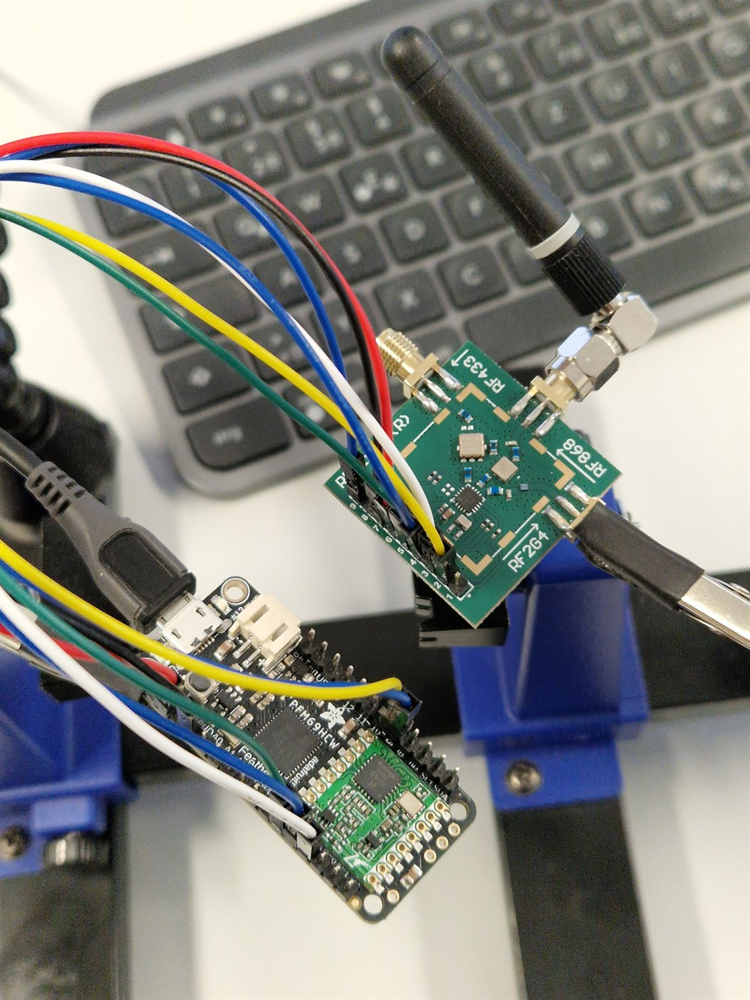

# FH101RF Hardware/Software Example

> Single-page version of the project wiki. Generated from the wiki pages in the
> `fh101rf-hw-sw-pex.wiki` repository - edit those files, not this document.

A complete, ready-to-use hardware and software example for the **RFicient® FH101RF**
wake-up receiver. The project runs on an **Adafruit Feather M0 RFM69HCW** together with an
**FH101RFBOB** breakout board. It lets you configure the FH101RF and generate a matching RF
signal in FH101RF format, so a wake-up link can be built and tested without any additional
tooling.

```
   FH101RFBOB (receiver)                Feather M0 RFM69HCW (controller + transmitter)
   +--------------------+               +--------------------------------------+
   |  FH101RF           |<--- SPI ----->|  SAMD21                              |
   |  wake-up receiver  |<--- GPO1 -----|  RFM69HCW  --> OOK telegram          |
   +--------------------+               +--------------------------------------+
```

## What you get

| Function | Description |
|---|---|
| Configure the FH101RF | Band, branch, FDD, IDM, data rates, LO target, IRQ source and clock mode through the `wurx` driver |
| Calibrate the receiver | Crystal start-up, LO calibration and comparator offset calibration, each with a bounded timeout and a status flag |
| Generate the RF signal | The RFM69HCW transmits an OOK telegram in FH101RF format (31-bit CodeA preamble at the low data rate, CodeB data at the high data rate, ID block) |
| Receive and evaluate | The FH101RF reports an IRQ, the driver reads correlator state, correlator value, ID reason and FIFO payload into an event store |
| Store the events | Optional interrupt memory (`WURXIRQSTORE`) keeps up to `MAXLISTENTRIES` events with timestamp, band information and payload |
| Show the result | All state and event data is printed on the Feather serial console |

## Status

The link test was measured on real hardware and is verified:

```
link: 14 of 14 telegrams received
rx #N: IRQ_STATUS 0x20, ID individual, band 868, payload AF FE 00 00 00 00  -> payload OK
```

One event every 3062 ms, no dropouts. All four example sketches compile unchanged.

## Start here

| If you want to … | Read |
|---|---|
| See the whole link working in ten minutes | [Getting started](#getting-started) |
| Understand the board and the antenna situation | [Hardware](#hardware) |
| Connect the BOB to the Feather | [Wiring](#wiring) |
| Know what is on the air | [Signal format](#signal-format) |
| Switch band or change the preset | [Configuration](#configuration) |
| Pick the right sketch | [Sketches](#sketches) |
| Integrate the driver into your own firmware | [Driver API](#driver-api) |
| See the measured numbers | [Measurements](#measurements) |
| Fix a link that does not work | [Troubleshooting](#troubleshooting) |

## Repository layout

```
.
├── wurx.c                  FH101RF driver implementation
├── wurx.h                  FH101RF driver API, register map and enums
├── LICENSE                 MIT license
├── FH101RFRX/              Ready-to-use receiver sketch
├── FH101RFTX/              Transmitter library (portable C11) + two examples
├── FH101TRX/               Ready-to-use link test on a single board
├── docs/                   Photo of the test setup
├── FH101RFBOB_en_V1R3.pdf  Breakout board documentation (LZE GmbH)
└── FH101RF_LZE_Datasheet_Revision_1p3b_A_1_1.pdf
```

## License

MIT. The FH101RFBOB documentation and the FH101RF datasheet are third-party documents and are
not covered by this license.

---

## Getting started

### What you need

| Part | Note |
|---|---|
| Adafruit Feather M0 RFM69HCW | SAMD21 board with the RFM69HCW transceiver on board |
| FH101RFBOB | Breakout board of the FH101RF wake-up receiver, EU or nonEU variant |
| 9 jumper wires | The BOB pin header is 0.1 in, the Feather has matching headers |
| USB cable | Power, programming and the serial console |
| Antenna for the BOB | SMA antenna matching the fitted SAW filter (see [Hardware](#hardware)) |

An antenna for the **RFM69** is not included with the Feather. The board works without one,
but only over a few centimetres — see the warning in [Hardware](#hardware).

### Step 1 — wire it up

The mandatory signals are VDD, GND, SCLK, MOSI, CS_N and GPO1. The complete table is in
[Wiring](#wiring); the short version for the Feather M0 RFM69HCW is:

| FH101RFBOB pin | Feather pin |
|---|---|
| 6 VDD | 3V3 |
| 7 GND | GND |
| 2 CS_N | D10 |
| 5 SCLK | D24 (SCK) |
| 4 MOSI | D23 |
| 3 MISO | D22 |
| 9 GPO1 | D9 |

Do **not** use D3, D4 or D8 — they belong to the on-board RFM69HCW.

### Step 2 — build and upload

The sketches are complete: every driver source they need is inside the sketch folder, there is
no library to install and no code to fill in. Open the folder in the Arduino IDE (the folder
name has to match the `.ino` name) or use `arduino-cli`:

```bash
arduino-cli compile --fqbn adafruit:samd:adafruit_feather_m0 FH101TRX
arduino-cli upload  --fqbn adafruit:samd:adafruit_feather_m0 -p COM10 FH101TRX
```

`arduino-cli upload` does not accept `--build-property`; switches have to be set in the sketch.

### Step 3 — watch the serial console

Open the port at **115200 baud**. A healthy start looks like this:

```
==================================================
 FH101TRX - FH101RF wake-up transceiver test
==================================================
tx: RFM69HCW, 868399963 Hz, 33092 chip/s, PA_BOOST
tx: power 13 dBm, RegPaLevel 0x5F (verified)
tx: ID 0x7DA8, payload AF FE, every 3000 ms
tx: mode sending
rx: IC version 0x41
rx: wurx_init() with the 868 MHz preset
    (xtal, LO and offset calibration)
rx: LO target 920 MHz -> IF 52 MHz
rx: init 111 ms, XTAL_GOOD 0x1, CALIB_STATUS 0x0, OK
rx: ACTUAL_BANDSELECT 0x2 (868 MHz active)
rx: BAND_BRANCH_CTRL 0x27, IRQ_SELECT 0x20, ID 0x7DA8

ready: sending every 3000 ms, listening for wake-up events

tx #1: ID 0x7DA8, 2 payload byte(s), 260 byte(s), 62855 us, 13 dBm
rx #1 after 1614 ms: IRQ_STATUS 0x20, ID individual, band 868, counter 51449358, payload AF FE 00 00 00 00  -> payload OK
   link: 1 of 1 telegrams received
```

The lines that matter:

| Line | Meaning |
|---|---|
| `IC version 0x41` | The BOB answers on SPI |
| `XTAL_GOOD 0x1` | The 32.768 kHz crystal is running |
| `CALIB_STATUS 0x0` | LO and comparator offset calibration succeeded |
| `ACTUAL_BANDSELECT 0x2` | The 868 MHz band path is active |
| `payload OK` | The received payload matches what was sent |
| `link: N of M` | Link statistic, `N == M` is the goal |

If one of these is missing, go to [Troubleshooting](#troubleshooting).

### Step 4 — judge the range honestly

The on-board RFM69HCW has **no antenna**, so the default sketch transmits at +13 dBm just to
bridge a few centimetres. Before you draw any conclusion about the receiver sensitivity, fit an
antenna and set `TX_POWER_DBM` back to a realistic −10 dBm. Details and the measured power
sweep are in [Measurements](#measurements).

### Next steps

- Switch to a different band: [Configuration](#configuration)
- Understand the telegram the transmitter produces: [Signal format](#signal-format)
- Build your own firmware on the driver: [Driver API](#driver-api)

---

## Hardware

### Test setup



*FH101RFBOB with its 868 MHz antenna (top) wired to the Adafruit Feather M0 RFM69HCW (bottom).
The antenna connector of the on-board RFM69HCW is empty.*

> **The on-board RFM69HCW has no antenna.** The Feather is shipped without one — neither a wire
> antenna at the ANT pad nor a u.FL module is fitted. The transmitter therefore radiates only a
> few centimetres, so **no significant radio range is possible in this state, and fitting an
> antenna is strongly recommended** before the range of the receiver is judged.
>
> Until an antenna is fitted the sketch compensates with the maximum output power
> (`TX_POWER_DBM 13`). A quarter-wave wire at the ANT pad (≈ 8.6 cm for 868 MHz, ≈ 8.2 cm for
> 915 MHz) or a u.FL antenna module restores a realistic operating point of about −10 dBm.

### Receiver — FH101RFBOB

- RFicient® FH101RF wake-up receiver, postage-stamp sized board (32 × 32.64 mm)
- RF filtering, matching network and clock generation on board
- Bands 433 / 868 / 2G4 (EU version) or 433 / 915 / 2G4 (nonEU version), selected by the SAW filter
- Antennas on SMA connectors, all control signals on a 0.1 in pin header
- Supply 1.6 V … 3.63 V, SPI up to 10 MHz, 3-wire or 4-wire SPI
- GPO1 / GPO2 are used as the interrupt output to wake up the MCU
- All BOB outputs are series connected through 1 kΩ resistors on the board

The GPIO levels of the BOB are defined by its VDD pin, so VDD and the MCU I/O voltage must
match. The BOB draws short current peaks while sampling — do not remove the recommended
capacitors.

### Controller and transmitter — Adafruit Feather M0 RFM69HCW

- SAMD21 Cortex-M0+, Arduino/PlatformIO compatible
- RFM69HCW transceiver (SX1231H), used in OOK packet mode as the FH101RF-format signal source
- USB serial console for configuration and event output
- No antenna fitted on the RFM69 — see the warning above

### EU vs. nonEU: the 868 / 915 MHz signal path

The FH101RF IC has three band paths (433, 868, 2G4). There is **no separate 915 MHz path** —
868 and 915 share the same path, the same matching network and the same SMA connector. What
differs between the two board versions is the **SAW filter fitted into that shared path**, and
that filter decides which of the two frequencies the board can actually hear:

| Board version | Receiving bands | SAW filter in the 868/915 path | Center frequency |
|---|---|---|---|
| `FH101RFBOB_EU_V1.0` | 433 / 868 / 2G4 | RF360 `B39871B3744H110` | **868.3 MHz** |
| `FH101RFBOB_nonEU_V1.0` | 433 / 915 / 2G4 | RF360 `B39921B3300H110` | **916.5 MHz** |

Both versions use the same 433 MHz filter (RF360 `B39431B3790Z810`, 433.9 MHz) and the same
2.4 GHz filter (RF360 `B39252B7556P810`, 2478 MHz); only the 868/915 position is populated
differently.

Consequences for using the board:

- **868 and 915 are mutually exclusive on one board.** The EU board cannot receive 915 MHz and
  the nonEU board cannot receive 868 MHz — the SAW filter in front of the receiver blocks the
  other frequency. A band that is not on the board cannot be enabled by software.
- **The software preset has to match the fitted filter, not the IC.** Both versions are
  configured through the same 868 MHz band path of the IC, so the only thing that changes in
  software is the LO target — see [Configuration](#configuration).
- The nonEU filter is centered at **916.5 MHz**, not 915 MHz. That is why the 915 preset is
  named `916` and why `lo_target_868 = 956` fits so well: 956 − 916.5 = **39.5 MHz**
  intermediate frequency, essentially the datasheet optimum of 40 MHz.
- Sensitivity is the same on both paths: −72 dBm at 868.3 MHz and −72 dBm at 916.5 MHz.
- The matching antenna for the nonEU board is the Linx `ANT-916-CW-HWR-SMA`
  (EU: `ANT-868-CW-HWR-SMA`).

Source: `FH101RFBOB_en_V1R3.pdf`, sections 1 (Introduction), 4 (Board structure, Table 3),
5 (Operating conditions) and 6 (Ordering information).

### See also

- [Wiring](#wiring) — pin assignment and the rules for the shared SPI bus
- [Configuration](#configuration) — which preset belongs to which board

---

## Wiring

The FH101RFBOB pin header is connected to the Feather. The GPIO levels of the BOB are defined
by its VDD pin, so VDD and the MCU I/O voltage must match.

### Connection diagram

```
   Adafruit Feather M0 RFM69HCW              FH101RFBOB (pin header)
   +---------------------------+            +------------------------+
   |                           |            |                        |
   |  3V3  --------------------+------------+-- 6  VDD   1.6-3.63 V |
   |  GND  --------------------+------------+-- 7  GND               |
   |                           |            |                        |
   |  SCK  (D24) --------------+------------+-- 5  SCLK   max 10 MHz |
   |  MOSI (D23) --------------+------------+-- 4  MOSI              |
   |  MISO (D22) --------------+------------+-- 3  MISO              |
   |  D10  --------------------+------------+-- 2  CS_N              |
   |                           |            |                        |
   |  D9   --------------------+------------+-- 9  GPO1 / IRQ        |
   |  D11  --------------------+------------+-- 1  RESET_N  optional |
   |  D6   --------------------+------------+-- 8  GPO2 / IRQ  opt.  |
   |                           |            |                        |
   +---------------------------+            +------------------------+

   mandatory : VDD, GND, SCLK, MOSI, CS_N, GPO1
   optional  : RESET_N (internal pull-up), MISO (3-wire SPI), GPO2
   reserved  : D3, D4, D8 are used by the on-board RFM69HCW
```

### Pin assignment

| FH101RFBOB pin | Name | Feather M0 | Direction | Note |
|---|---|---|---|---|
| 1 | RESET_N | D11 | MCU → BOB | optional, BOB has an internal pull-up |
| 2 | CS_N | D10 | MCU → BOB | mandatory, SPI slave select |
| 3 | MISO | MISO (D22) | BOB → MCU | 3-wire SPI: shared with MOSI |
| 4 | MOSI | MOSI (D23) | MCU → BOB | mandatory |
| 5 | SCLK | SCK (D24) | MCU → BOB | mandatory, max. 10 MHz |
| 6 | VDD | 3V3 | — | 1.6 V … 3.63 V |
| 7 | GND | GND | — | mandatory |
| 8 | GPO2 | D6 | BOB → MCU | optional, interrupt output, function set by register 0x75 |
| 9 | GPO1 | D9 | BOB → MCU | interrupt output, function set by register 0x75 |

The CS and IRQ pins are configurable in the platform layer (`fh101rf_config.h`); D10 and D9 are
the proposed assignment. Use a pin that supports deep-sleep wake-up if the MCU is meant to be
woken by the receiver.

SPI configuration: **mode 0, MSB first, 4 MHz** in the sketches (the BOB allows up to 10 MHz).
The BOB supports 3-wire and 4-wire SPI; the sketches use 4-wire.

### Both radio chips on one bus

In the single-board link test (`FH101TRX`) both radio chips share the same SPI bus:

| Signal | RFM69HCW (on-board) | FH101RFBOB |
|---|---|---|
| CS | D8 | D10 (`CS_N`) |
| IRQ / GPO | D3 (DIO0) | D9 (`GPO1`) |
| RESET | D4 (active HIGH) | not wired |
| SCK | D24 | D24 |
| MOSI | D23 | D23 |
| MISO | D22 | D22 |

#### Rules for the shared bus

These three points are not a matter of style, they are the precondition for the setup to work
at all:

1. **Exactly one chip may be selected at a time.** `spiBusIdle()` pulls both CS HIGH and wraps
   every radio access in the sketch.
2. **The direction bits are opposite:** on the RFM69 bit 7 = 1 means *write*, on the FH101RF
   bit 7 = 1 means *read*. An accidental access to the wrong chip is therefore a **valid
   command** there and is executed instead of ignored.
3. **`rfm69_ook_send()` keeps one SPI transaction open for the whole telegram (~63 ms).** The
   FH101RF must not be touched inside that window. The sketch therefore reads the latched IRQ
   **before** the next transmission.

In addition the CS of the FH101RF has to be firmly HIGH before the first SPI traffic: `setup()`
sets both CS before any driver initialises the bus. The FH101RF has no wired reset (`RESET_N`
open) and cannot recover from a foreign register access by itself.

### Adapting the pins

All hardware parameters are in `fh101rf_config.h` and can also be overridden by a compiler
define:

```cpp
#define FH101RF_CS_PIN      10    // CS_N
#define FH101RF_IRQ_PIN      9    // GPO1
#define FH101RF_RESET_PIN   -1    // RESET_N, -1 = not wired
#define FH101RF_SPI_HZ  4000000UL // max. 10 MHz
```

For the wiring shown above `RESET_N` is on D11, so set `FH101RF_RESET_PIN 11` if you want to
use it.

---

## Signal format

The transmitter has to match the receiver configuration, otherwise no wake-up event is
generated. This page describes what is on the air.

### Telegram structure

According to datasheet section 5.6 (figure 6), table 16 and table 23:

| Section | Transmit rate | Length | Content |
|---|---|---|---|
| 1. Preamble | 1 kbit/s (LDR) | 32 bit = 32 ms | CodeA `0x6ACD674F`, every bit spread over 32 chips |
| 2. Pause | — | 32 chips = 0.98 ms | Transmitter pause, receiver switches to HDR (TP1 = 5.371 ms max.) |
| 3. ID block | 32 kbit/s (HDR) | 16 bit = 15.6 ms | ID MSB first, `CodeA` = 0, `CodeB` = 1 |
| 4. Payload | 32 kbit/s (HDR) | `size` × 8 bit | User data MSB first, same encoding |

- **CodeA** (logical 0): `0x6A 0xCD 0x67 0x4F` (mlsA, datasheet table 23)
- **CodeB** (logical 1): `0x6D 0x38 0x97 0x73` (mlsB, datasheet table 23)

The preamble is transmitted at 1 kbit/s, the data at 32 kbit/s. Because the chip stream runs
continuously at 32.768 kchip/s, every preamble bit is repeated 32 times (spreading factor
`WURX_TG_PREAMBLE_SPREAD = 32`).

The generated buffer is bit-packed: bit 7 of byte 0 is the first chip. Chip = 1 means RF on,
chip = 0 means RF off.

### Chip rate

The chips have to be clocked at `WURX_TG_TX_CHIP_RATE_HZ` = **33096 Hz**. According to datasheet
section 5.8 that is 1 % more than the sampling rate of the receiver (32768 Hz), i.e.
`fTX = 1.01 × 32768`.

The RFM69HCW derives this from its own crystal: `RegBitrate = 967` gives 32 MHz / 967 =
33092 Hz, which is 1.0099 × 32768 Hz — inside tolerance.

### Timing

| Telegram | Chips | Duration at 33096 Hz |
|---|---|---|
| ID only | 1568 | 47.4 ms |
| ID + 1 byte | 1824 | 55.1 ms |
| ID + 2 bytes | 2080 | 62.9 ms |
| ID + 6 bytes | 3104 | 93.8 ms |

After the telegram the receiver has to fall back to LDR (TP2 = 1.53 ms) before the next
telegram starts.

The default link test uses ID `0x7DA8` with a 2 byte payload `AF FE`, which is 260 bytes /
2080 chips / 62855 µs on the air.

### Buffer size

`wurx_tg_generate()` uses an internal buffer of size `WURX_TG_BUFFER_SIZE` (default 388 bytes =
ID + 6 bytes payload). For longer payloads increase `WURX_TG_BUFFER_SIZE` or use
`wurx_tg_build()` with its own buffer. Space required: `196 + 32 × size` bytes.

The receiver FIFO holds only 16 bit = 2 bytes by default (register 0x56 `FIFO_LENGTH`, values
16/24/32/40 bit). Longer payloads can be transmitted, but the receiver only captures them up to
the configured FIFO length.

### OOK requirements

- The transmitter has to deliver **true OOK modulation**: below −60 dBm (better −80 dBm) in the
  low level. A carrier that only dips slightly is not detected.
- The data rate has to stay within tolerance, otherwise the receiver detects no chips.
- MSB first. The library already generates the sequence in that order.

### See also

- [Configuration](#configuration) — presets, bands and the LO target
- [Driver API](#driver-api) — how the receiver side of the format is configured

---

## Configuration

### Presets

The driver ships four presets in `wurx.c` / `wurx.h`:

| Preset | Band | Preamble | Data | LO target | IRQ source |
|---|---|---|---|---|---|
| `wurx_conf_433_1k_32k_idm2slow_allbranch_dout1` | 433 MHz | 1 kbit/s | 32 kbit/s | 470 MHz | `WURX_IDMANDSLOW_IRQ` |
| `wurx_conf_868_1k_32k_idm2slow_allbranch_dout1` | 868 MHz | 1 kbit/s | 32 kbit/s | 920 MHz | `WURX_IDMANDSLOW_IRQ` |
| `wurx_conf_916_1k_32k_idm2slow_allbranch_dout1` | 915 MHz | 1 kbit/s | 32 kbit/s | 956 MHz | `WURX_IDMANDSLOW_IRQ` |
| `wurx_conf_2g4_1k_32k_idm2slow_allbranch_dout1` | 2.4 GHz | 1 kbit/s | 32 kbit/s | 2440 MHz | `WURX_IDMANDSLOW_IRQ` |

All presets use all branches (strong, medium, weak), individual ID `0x7da8`,
`WURX_XTAL_CLK` and `WURX_IRQ_EVENT_HIGH` as output mux.

Select a preset and initialize the receiver:

```c
if(wurx_init(wurx_conf_868_1k_32k_idm2slow_allbranch_dout1))
{
    /* receiverGood: xtal ok, LO cal done, offset cal done */
}
```

`wurx_init()` runs the complete power-up sequence: crystal start-up (`XTAL_GOOD`), LO
calibration and comparator offset calibration. The call takes typically about 1 s, because
`XTAL_GOOD` is only set after roughly 0.5 s.

### 915 MHz

The 915 MHz preset is meant for the **nonEU variant** of the FH101RFBOB (the one with the
433 / 915 / 2G4 SAW filters). The IC itself has no separate 915 MHz band, so the preset drives
the **868 MHz band path** — 868 and 915 share one path on the board and are separated only by
the fitted SAW filter (EU: 868.3 MHz, nonEU: 916.5 MHz). See [Hardware](#hardware) for the
filter table.

> **The only difference between the 868 MHz and the 915 MHz setting is the LO target:**
> `lo_target_868 = 956` instead of `920`. Band selector, branch selector, FDD and IDM
> selectors, data rates, IRQ source, ID and output mux are identical. Keep it that way — if the
> 868 preset is ever changed, change the 915 preset the same way and leave `lo_target_868` as
> the single differing value.

To switch in a sketch, swap the preset variable:

```c
wurx_config_t rxConfig = wurx_conf_916_1k_32k_idm2slow_allbranch_dout1;
```

On an EU board it stays with the 868 preset — the 915 MHz filter is not fitted there.

### The LO target is not the carrier frequency

`lo_target_868` is the frequency of the free-running oscillator, **not** the carrier
frequency. An 868.4 MHz carrier lands at |868.4 − fLO| MHz:

| LO target | Carrier | IF | Note |
|---|---|---|---|
| 920 MHz (868 preset) | 868.4 MHz | **52 MHz** | datasheet recommends 30…50 MHz, optimum 40 |
| 908 MHz (experiment) | 868.4 MHz | 40 MHz | measured **worse**, see below |
| 956 MHz (916 preset) | 916.5 MHz | **39.5 MHz** | nonEU filter center, right at the optimum |
| 956 MHz (916 preset) | 915.0 MHz | 41 MHz | a carrier exactly on the band edge |

The 30…50 MHz figure is a recommendation, not a hard limit. The change to 908 MHz was measured
on hardware and made the link **worse**: the first reception needed 10 dBm instead of 0 dBm.
The preset therefore stays at 920 MHz. Details in [Measurements](#measurements).

### Sketch switches

The link test `FH101TRX` has all switches at the top of `FH101TRX.ino`:

| Define | Default | Meaning |
|---|---|---|
| `TX_FREQ_HZ` | `868400000UL` | Carrier frequency |
| `TX_REPEAT_MS` | `3000UL` | Transmit interval |
| `TX_ID` | `WURX_TG_DEFAULT_ID` | Wake-up ID, has to match the receiver ID |
| `TX_POWER_DBM` | `13` | Transmit power, −18 … +13 dBm |
| `TX_SEND_ENABLE` | `1` | `1` = transmit, `0` = receive only |
| `RX_LISTEN_MS` | `10000UL` | Length of a receive window (marker in the log only) |

`TX_SEND_ENABLE 0` turns the board into a pure receiver: the RFM69 is initialised and set to its
power, but never keyed. This lets you check an **external** transmitter without your own carrier
sitting on the receiver.

The transmit power is written at runtime through `rfm69_ook_set_power_dbm()`. A `#define` in the
`.ino` is not sufficient on its own, because `RFM69_TX_POWER_DBM` is compiled in as a constant
inside `rfm69_ook.cpp`.

### RFM69 OOK register set

The transmitter driver configures the RFM69HCW like this:

| Register | Address | Value | Meaning |
|---|---|---|---|
| `RegOpMode` | `0x01` | `0x04` / `0x0C` | Standby / TX |
| `RegDataModul` | `0x02` | `0x08` | DataMode `00` = **packet mode**, OOK, no shaping |
| `RegBitrate` | `0x03/0x04` | `0x03C7` = 967 | 32 MHz / 967 = **33092 Hz** |
| `RegFrf` | `0x07..0x09` | `0xD91999` | **868.4 MHz** |
| `RegPreambleMsb/Lsb` | `0x2C/0x2D` | `0x0000` | no additional preamble |
| `RegSyncConfig` | `0x2E` | `0x00` | sync word off |
| `RegPacketConfig1` | `0x37` | `0x00` | fixed length, **no CRC**, no DC-free, no address filtering |
| `RegPacketConfig2` | `0x3D` | `0x00` | no AES, no auto RX restart |
| `RegPayloadLength` | `0x38` | `0x00` | **unlimited length packet format** |
| `RegFifoThresh` | `0x3C` | `0x80` | TX starts as soon as the FIFO is not empty |
| `RegPaLevel` | `0x11` | `0x40 \| (dBm + 18)` | PA_BOOST (PA1), e.g. `0x52` = 0 dBm, `0x5F` = +13 dBm |
| `RegPaRamp` | `0x12` | `0x0F` | shortest ramp (10 µs), no shaping |
| `RegOcp` | `0x13` | `0x1A` | over-current protection on, 95 mA |
| `RegDioMapping2` | `0x26` | `0x07` | clock out off |

**Packet mode is mandatory.** In continuous mode the FIFO and packet handler are inactive
(datasheet 5.4.1): every FIFO write is discarded and the PA transmits a flat, unmodulated
carrier. See [Troubleshooting](#troubleshooting) for the full story.

---

## Sketches

All example projects in this repository are **complete, ready-to-use Arduino sketches**. They
compile as they are, contain every driver source they need and work with nothing but the wiring
shown in [Wiring](#wiring) — no extra libraries to install and no code to fill in.

| Sketch | Board | What it does | Size |
|---|---|---|---|
| `FH101TRX` | Feather M0 RFM69HCW + FH101RFBOB | Complete link test on a single board: the on-board RFM69HCW sends, the FH101RFBOB receives. **Start here.** | 28664 B |
| `FH101RFRX` | Feather M0 RFM69HCW + FH101RFBOB | Receiver only: configures the FH101RF, prints the init status and reports every wake-up event | 25708 B |
| `WurxTelegramSendRfm69` | Feather M0 RFM69HCW | Transmitter only: sends the wake-up telegram with the on-board RFM69HCW | 22288 B |
| `WurxTelegramDump` | any Arduino board | No radio and no FH101RF needed: generates the telegram, decodes it back and prints it as a hexdump | 4170 B |

Every sketch folder carries its own copy of the driver sources it uses, so the folders are
self-contained and can be copied out of the repository on their own. The only thing to adapt is
the pin assignment in `fh101rf_config.h` if the wiring differs.

### FH101TRX — the link test

The shortest way to see the whole chain working. One board sends and receives at the same time:
the RFM69HCW transmits a wake-up telegram every `TX_REPEAT_MS`, the FH101RFBOB listens for it.

- TX: `rfm69_ook.cpp`, OOK packet mode, telegram from `wurx_telegram.c`
- RX: `wurx.c` with the 868 MHz preset
- Output: IRQ status, ID type, band, counter, payload and a `link: N of M` statistic

Both chips share one SPI bus, so the three rules from [Wiring](#wiring) apply. This sketch is the
reference implementation for that.

### FH101RFRX — receiver only

Initialises the FH101RF, prints the complete init status and then reports every wake-up event.
Use it when the transmitter is a separate device, or when you want to check the receiver side in
isolation.

Output of a healthy start:

```
IC version (reg 0x7F) : 0x41
init time             : 1002 ms
XTAL_GOOD (0x77)      : 1, clock stable
CALIB_STATUS (0x06)   : 0x0
ACTUAL_BANDSELECT     : 0x2 (868 MHz active)
receiver state        : OK
receiver is listening for 868 MHz wake-up telegrams
```

### WurxTelegramSendRfm69 — transmitter only

Sends the same telegram with the on-board RFM69HCW (SX1231H). The chip runs in **OOK packet mode
with unlimited length packet format**: the bytes are written into the 66 byte FIFO and the chip
clocks them out bit by bit at the rate set in `RegBitrate`. The chip stream is therefore as
accurate as the module crystal — no bit-banging in the main program.

Serial console commands:

| Key | Function |
|---|---|
| `s` | send one telegram |
| `t` / `T` | telegram repetition on / off |

Without a key press the sketch sends every `TX_REPEAT_MS` (default 2000 ms).

### WurxTelegramDump — no hardware needed

Generates an ID-only and an ID+payload telegram, prints size, chip count, duration and hexdump
and **decodes the result back** (preamble, ID, payload), so the serial output proves the
correctness directly:

```
--- ID only ---
ID                 : 0x7DA8, payload 0 byte(s)
telegram size      : 196 byte(s)
chips              : 1568, duration at 33096 Hz: 47 ms
preamble           : 32 bit at 1024 bit/s, spread x32
verify             : OK
```

This is the sketch to use when you only want to verify the telegram generator, or when you need
the chip stream for a different transmitter.

### Building

```bash
arduino-cli compile --fqbn adafruit:samd:adafruit_feather_m0 FH101TRX
arduino-cli compile --fqbn adafruit:samd:adafruit_feather_m0 FH101RFRX

arduino-cli compile --fqbn arduino:avr:uno --library FH101RFTX FH101RFTX/examples/WurxTelegramDump
arduino-cli compile --fqbn adafruit:samd:adafruit_feather_m0 --library FH101RFTX FH101RFTX/examples/WurxTelegramSendRfm69
```

The two examples inside `FH101RFTX/` use `--library FH101RFTX` because they include
`wurx_telegram.h` from the library folder. In the Arduino IDE the library has to be installed
(copy or link the folder `FH101RFTX` into `<sketchbook>/libraries/`).

Note: `examples/WurxTelegramDump/` additionally contains copies of `wurx_telegram.c` and
`wurx_telegram.h`. These copies take precedence over the library as long as they sit in the
sketch folder.

---

## Driver API

The driver is plain C11 without any RTOS dependency. Two files, no other includes:

| File | Content |
|---|---|
| `wurx.h` | API, register map, enums and the preset declarations |
| `wurx.c` | Implementation |

### Platform hooks

The only platform dependency are three functions the application has to provide. They are
declared **weak**, so a sketch that only references a preset can be linked without implementing
SPI at all:

```c
void    wurx_write_reg(uint8_t addr, uint8_t value);
uint8_t wurx_read_reg(uint8_t addr);
void    wurx_reset_register(void);   /* weak, empty default */
```

In the sketches these live in `fh101rf_platform.cpp`:

```cpp
static const SPISettings fh101rfSpiSettings(FH101RF_SPI_HZ, MSBFIRST, SPI_MODE0);

extern "C" void wurx_write_reg(uint8_t addr, uint8_t val)
{
    SPI.beginTransaction(fh101rfSpiSettings);
    digitalWrite(FH101RF_CS_PIN, LOW);
    SPI.transfer((uint8_t)(addr & 0x7F));   /* bit 7 = 0 -> write */
    SPI.transfer(val);
    digitalWrite(FH101RF_CS_PIN, HIGH);
    SPI.endTransaction();
}

extern "C" uint8_t wurx_read_reg(uint8_t addr)
{
    uint8_t val;

    SPI.beginTransaction(fh101rfSpiSettings);
    digitalWrite(FH101RF_CS_PIN, LOW);
    SPI.transfer((uint8_t)(addr | 0x80));   /* bit 7 = 1 -> read */
    val = SPI.transfer((uint8_t)0x00);      /* dummy byte clocks the value out */
    digitalWrite(FH101RF_CS_PIN, HIGH);
    SPI.endTransaction();

    return val;
}
```

> **Do not include `wurx.h` in the platform file.** The header declares the hooks with
> `__attribute__((weak))`. Including it would make your definitions weak as well and the driver's
> weak defaults would win. Without the include they are strong.

The SPI protocol is mode 0, MSB first, max. 10 MHz, CS_N active low. Bit 7 of the header byte
selects the direction: **1 = read, 0 = write**. The RFM69HCW on the same bus uses the opposite
convention (1 = write), which is why a stray access can never be harmless — see
[Wiring](#wiring).

### Initialize the receiver

```c
if(wurx_init(wurx_conf_868_1k_32k_idm2slow_allbranch_dout1))
{
    /* receiverGood: xtal ok, LO cal done, offset cal done */
}
```

`wurx_init()` runs crystal start-up, LO calibration and comparator offset calibration, each with
a bounded timeout. It returns non-zero on success and takes typically about 1 s.

It only returns the overall status. Details are read back through the status registers:

| Register | Name | Expected |
|---|---|---|
| `0x7F` | IC version | `0x41` |
| `0x77` | `XTAL_GOOD` | `0x1` |
| `0x06` | `CALIB_STATUS` | `0x0` |
| — | `ACTUAL_BANDSELECT` | `0x2` for the 868 MHz path |
| — | `BAND_BRANCH_CTRL` | `0x27` with all branches |
| — | `IRQ_SELECT` | `0x20` for `WURX_IDMANDSLOW_IRQ` |

### Handle an interrupt

The ISR writes the event data directly into the entry the caller passes in:

```c
void irq_handler(void)
{
    wurx_irq_event_cont_store_t *store = wurx_get_irq_event_array();

    if(store->wurx_irqevent_store_counter < MAXLISTENTRIES)
    {
        wurx_irq_handler(&store->wurx_irqevent_store[store->wurx_irqevent_store_counter]);
        store->wurx_irqevent_store_counter++;
    }
}
```

The caller is responsible for the counter bound — `wurx_irq_handler()` does not check it. Call
`wurx_clear_irq_count()` after the entries were processed.

The event store is optional and only compiled in with `WURXIRQSTORE`:

```
build_flags = -DWURXIRQSTORE
```

Read the events back with `wurx_get_irq_event_last()` and `wurx_get_irq_event_counter()`.

### Telegram generator (separate library)

`FH101RFTX/src/wurx_telegram.c` is independent of the receiver driver and has no platform
dependency at all:

```c
#include <wurx_telegram.h>

/* generate a telegram, the buffer is provided by the library */
uint16_t wurx_tg_generate(uint16_t id, uint8_t size, const uint8_t *data);
const uint8_t *wurx_tg_get_telegram(void);

/* generate a telegram into an own buffer */
uint16_t wurx_tg_build(uint16_t id, uint8_t size, const uint8_t *data,
                       uint8_t *telegram, uint16_t telegramSize);

/* helpers */
uint16_t wurx_tg_chips(uint8_t size);   /* number of chips */
uint16_t wurx_tg_size(uint8_t size);    /* number of bytes */
uint8_t  wurx_tg_get_chip(const uint8_t *telegram, uint16_t chipIndex);
```

- `size == 0` → only the ID is transmitted (196 bytes / 1568 chips)
- `data == NULL` is only allowed with `size == 0`
- return value `0` means error (buffer too small, `data` NULL with `size > 0`)

Example:

```c
uint8_t payload[2] = {0xA5, 0x5A};

wurx_tg_generate(0x7DA8, 0, NULL);          /* ID only */
uint16_t len = wurx_tg_generate(0x7DA8, 2, payload);  /* ID + 2 bytes */
```

The chips then have to be clocked out at 33096 Hz — see [Signal format](#signal-format). The
reference implementation in the README uses **absolute deadlines** instead of
`delayMicroseconds()` per chip, so the mean chip rate stays exact.

### Reference implementation for an external OOK transmitter

If you key an external OOK module through a GPIO instead of using the RFM69, this pattern works
on AVR and SAMD:

```c
static uint32_t txSendTelegram(const uint8_t *telegram, uint16_t chips)
{
    uint32_t start = micros();
    uint32_t next = start;
    uint32_t fraction = 0;

    for (uint16_t chip = 0; chip < chips; chip++)
    {
        while ((int32_t)(micros() - next) < 0) { }   /* absolute deadline */

        txCarrier(wurx_tg_get_chip(telegram, chip)); /* 1 = RF on, 0 = RF off */

        fraction += TX_CHIP_PERIOD_Q16;              /* 30.215 µs in Q16 */
        next += (fraction >> 16);
        fraction &= 0xFFFFUL;
    }
    txCarrier(0);

    return micros() - start;
}
```

Measured 33094.6 Hz with the 4 µs resolution of `micros()` on AVR, error −0.004 %. The unsigned
subtraction keeps the logic correct at the `micros()` overflow.

---

## Measurements

All numbers on this page were measured on real hardware: Adafruit Feather M0 RFM69HCW with an
FH101RFBOB (EU variant, 868 MHz SAW filter) wired as shown in [Wiring](#wiring).

### Link test

```
link: 14 of 14 telegrams received
rx #N: IRQ_STATUS 0x20, ID individual, band 868, payload AF FE 00 00 00 00  -> payload OK
```

One event every 3062 ms, no dropouts over the whole run. A second run after the sketch was
cleaned up gave 9 of 9.

Receiver init, all green:

| Item | Value |
|---|---|
| IC version | `0x41` |
| `XTAL_GOOD` | `0x1` |
| `CALIB_STATUS` | `0x0` |
| `ACTUAL_BANDSELECT` | `0x2` (868 MHz active) |
| `BAND_BRANCH_CTRL` | `0x27` |
| `IRQ_SELECT` | `0x20` |
| Init time | ~111 ms (the driver allows up to ~1 s) |
| Telegram duration | 62855 µs |
| Counter increment per telegram | +100389 (32.768 kHz ticks of the receiver, not telegrams) |

### Transmit power sweep

The Feather has no antenna on the RFM69. A sweep with one power step per telegram shows what
that costs:

| Power | `RegPaLevel` | Reception |
|---|---|---|
| −18 dBm | `0x40` | ✗ |
| −10 dBm | `0x48` | ✗ |
| −4 dBm | `0x4E` | ✗ |
| 0 dBm | `0x52` | ✓ |
| 5 dBm | `0x57` | ✓ |
| 10 dBm | `0x5C` | ✓ |
| 13 dBm | `0x5F` | ✓ |

The threshold sits at 0 dBm, roughly **18 dB above** what a matched antenna would need. That is
the missing antenna, not a receiver problem.

#### The receiver was verified separately

The same setup was used to listen to an **external** transmitter at 15 cm distance with the
on-board RFM69 switched off (`TX_SEND_ENABLE 0`). Result: **17 of 17** telegrams received at
full sensitivity. The receive chain was never the fault.

Conclusion: keep `TX_POWER_DBM 13` while the board has no antenna, and set it back to a
realistic −10 dBm once an antenna is fitted.

### Intermediate frequency experiment

`lo_target_868` is the free-running oscillator, not the carrier. The 868 preset uses 920 MHz,
which puts an 868.4 MHz carrier at 52 MHz IF — outside the 30…50 MHz the datasheet recommends
(optimum 40 MHz).

The obvious fix was tried: `RX_LO_TARGET_MHZ 908` gives exactly 40 MHz IF.

| LO target | IF | First reception needed |
|---|---|---|
| 920 MHz (preset) | 52 MHz | **0 dBm** |
| 908 MHz (experiment) | 40 MHz | 10 dBm |

The "optimum" was **worse** by 10 dB. The 30…50 MHz window is a recommendation, not a limit;
the correlator copes with the wider IF. The preset was left at 920 MHz.

This is also why the 915 MHz preset at 956 MHz is a good fit: 956 − 916.5 = 39.5 MHz, right at
the datasheet optimum, without touching the 868 setting.

### Compile sizes

| Sketch | FQBN | Flash |
|---|---|---|
| `FH101TRX` | `adafruit:samd:adafruit_feather_m0` | 28664 B (10 %) |
| `FH101RFRX` | `adafruit:samd:adafruit_feather_m0` | 25708 B |
| `WurxTelegramSendRfm69` | `adafruit:samd:adafruit_feather_m0` | 22288 B |
| `WurxTelegramDump` | `arduino:avr:uno` | 4170 B |

### Telegram generator verification

Checked against the examples from the datasheet:

| ID | Expected sequence (fast) | Result |
|---|---|---|
| `0xB000` | `BABB AAAA AAAA AAAA` | OK |
| `0x032F` (broadcast) | `AAAA AABB AABA BBBB` | OK |

Plus a round-trip test covering preamble spreading, pause, ID and payload decoding, lengths and
error cases.

---

## Troubleshooting

Every entry here comes from a fault that actually occurred during bring-up of this project.

### Nothing is received at all

Check in this order:

1. **Antenna.** The on-board RFM69HCW ships without one and only reaches a few centimetres. The
   measured threshold was 0 dBm with no antenna — see [Measurements](#measurements). If
   `TX_POWER_DBM` is at a realistic value such as −10 dBm, the link cannot work. Either raise the
   power to 13 dBm for the test or fit an antenna.
2. **Init status.** `XTAL_GOOD` has to be `0x1`, `CALIB_STATUS` `0x0`. If not, the crystal or the
   supply is the problem — the BOB draws short current peaks, do not remove its capacitors.
3. **Preset vs. board.** An EU board cannot hear 915 MHz and a nonEU board cannot hear 868 MHz.
   See [Hardware](#hardware).
4. **Payload check.** A payload mismatch still produces an event, so a missing event is never a
   payload problem. See the FIFO entry below.

### `RFM69HCW not found`

The sketch prints the version it actually read, the SPI clock and the result of a register
write/read test:

| Output | Meaning |
|---|---|
| `RegVersion : 0x24` | Module detected, everything fine |
| `RegVersion : 0x00` + `register test FAILED` | SPI bus delivers no data — wrong board, wrong pins or no supply |
| `RegVersion : 0x00` + `register test OK` | Bus works, but the part is not an RFM69 (or is held in reset) |
| `RegVersion : 0x12` | it is an SX127x/LoRa module, not an RFM69 |

The original cause of this error was a missing `SPI.begin()`. On SAMD,
`SPI.beginTransaction()` alone does not enable the SERCOM peripheral — every transfer reads
`0x00`. `rfm69_ook_begin()` now calls `SPI.begin()` itself and retries `RegVersion` with a
descending clock (8 MHz, 4 MHz, 1 MHz, 250 kHz).

### `RegVersion` reads fine but every write is ignored

The RESET pin of the RFM69 (D4) is **active HIGH**. While D4 is HIGH the chip still answers
reads (returning the reset defaults) but silently discards every write. Symptoms:

- `RegVersion` reads `0x24`, the module counts as detected
- a register write/read test fails (`0x00` instead of `0xA5`)
- a register dump shows only defaults (`RegBitrate = 0x1A0B`, `RegFrf = 0x000000`,
  `RegPaLevel = 0x9F`)
- the transmit duration is far too short, because the bit rate was never programmed

Proven with bit-banged SPI on the same board:

| D4 | Write access |
|---|---|
| LOW | works |
| HIGH | is ignored (reading still works) |
| open (input) | works, the module pulls the pin down itself |

`rfm69Reset()` pulses D4 briefly HIGH and leaves it **LOW** afterwards.

### The PA transmits, but nothing is modulated

This was the hardest fault. The spectrum analyser showed a signal, but with 4.4 % envelope swing
instead of ~90 %.

Cause: the RFM69 was configured in **continuous mode** (`RegDataModul = 0x48`). Datasheet
SX1231H 5.4.1: *"in Continuous mode the NRZ data to (from) the (de)modulator is directly
accessed by the uC on the bidirectional DIO2/DATA pin. The FIFO and packet handler are thus
inactive."* Every FIFO write was discarded and the PA sent a flat carrier.

The FIFO round-trip test made it obvious:

```
fifo @ datamodul 0x0  : 8/8, first 0x11     <- packet mode, FIFO works
fifo @ datamodul 0x48 : 0/8, first 0x0      <- continuous, FIFO switched off
```

Fix: **packet mode with unlimited length packet format** — `RegDataModul = 0x08`,
`PacketFormat = 0`, `PayloadLength = 0x00`, `PreambleLength = 0`, `SyncOn = 0`. The packet
handler then appends nothing and the FIFO bytes go into the modulator 1:1. Since then the drain
time scales with `1/RegBitrate` (46768 µs at 967, 93467 µs at 1934, 225740 µs at 4835,
23478 µs at 484) and the envelope shows 93 % swing.

### Payload compare never matches

The receiver FIFO returns **its whole depth**, not just the received bytes. A telegram with two
payload bytes appears as `AF FE 00 00 00 00`, so a test for `fifo_count == 2` can never pass.

Compare only the leading `TX_PAYLOAD_SIZE` bytes. The default FIFO length is 16 bit = 2 bytes
(register 0x56 `FIFO_LENGTH`, values 16/24/32/40 bit); longer payloads are silently truncated.

### The counter jumps by 100389 per telegram

That is correct. The counter counts the 32.768 kHz ticks of the receiver, not the telegrams.

### The board hangs and does not recover

A hang was observed once and could only be cleared by a manual reset — the sketch is not
self-recovering. The FH101RF has no wired reset (`RESET_N` open), so a foreign register access
cannot be undone from software.

This is why the shared-bus discipline in [Wiring](#wiring) matters, and why both CS lines are
driven HIGH in `setup()` before any driver touches the bus.

### `arduino-cli upload` rejects `--build-property`

Correct, `upload` does not accept it. Put the switches in the sketch instead.

### IntelliSense reports missing `Arduino.h` / `SPI.h`

There is no Arduino include path configured for the workspace, so VS Code cannot resolve them
for `.ino` files. `arduino-cli` compiles clean — this is not a real error.

