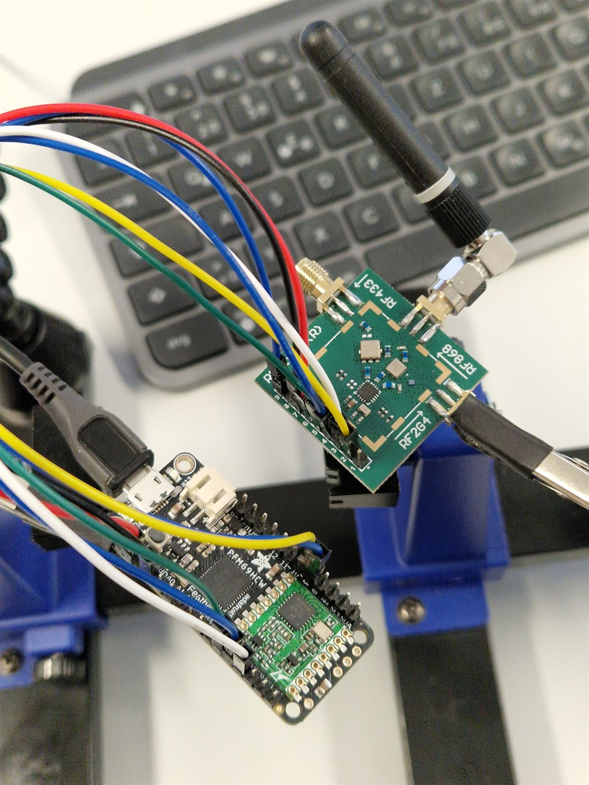

# Hardware

## Test setup

*FH101RFBOB with its 868 MHz antenna (top) wired to the Adafruit Feather M0 RFM69HCW (bottom).
The antenna connector of the on-board RFM69HCW is empty.*

> **The on-board RFM69HCW has no antenna.** The Feather is shipped without one — neither a wire
> antenna at the ANT pad nor a u.FL module is fitted. The transmitter therefore radiates only a
> few centimetres, so **no significant radio range is possible in this state, and fitting an
> antenna is strongly recommended** before the range of the receiver is judged.
>
> Until an antenna is fitted the sketch compensates with the maximum output power
> (`TX_POWER_DBM 13`). A quarter-wave wire at the ANT pad (≈ 8.6 cm for 868 MHz, ≈ 8.2 cm for
> 915 MHz) or a u.FL antenna module restores a realistic operating point of about −10 dBm.

## Receiver — FH101RFBOB

- RFicient® FH101RF wake-up receiver, postage-stamp sized board (32 × 32.64 mm)
- RF filtering, matching network and clock generation on board
- Bands 433 / 868 / 2G4 (EU version) or 433 / 915 / 2G4 (nonEU version), selected by the SAW filter
- Antennas on SMA connectors, all control signals on a 0.1 in pin header
- Supply 1.6 V … 3.63 V, SPI up to 10 MHz, 3-wire or 4-wire SPI
- GPO1 / GPO2 are used as the interrupt output to wake up the MCU
- All BOB outputs are series connected through 1 kΩ resistors on the board

The GPIO levels of the BOB are defined by its VDD pin, so VDD and the MCU I/O voltage must
match. The BOB draws short current peaks while sampling — do not remove the recommended
capacitors.

## Controller and transmitter — Adafruit Feather M0 RFM69HCW

- SAMD21 Cortex-M0+, Arduino/PlatformIO compatible
- RFM69HCW transceiver (SX1231H), used in OOK packet mode as the FH101RF-format signal source
- USB serial console for configuration and event output
- No antenna fitted on the RFM69 — see the warning above

## EU vs. nonEU: the 868 / 915 MHz signal path

The FH101RF IC has three band paths (433, 868, 2G4). There is **no separate 915 MHz path** —
868 and 915 share the same path, the same matching network and the same SMA connector. What
differs between the two board versions is the **SAW filter fitted into that shared path**, and
that filter decides which of the two frequencies the board can actually hear:

| Board version | Receiving bands | SAW filter in the 868/915 path | Center frequency |
|---|---|---|---|
| `FH101RFBOB_EU_V1.0` | 433 / 868 / 2G4 | RF360 `B39871B3744H110` | **868.3 MHz** |
| `FH101RFBOB_nonEU_V1.0` | 433 / 915 / 2G4 | RF360 `B39921B3300H110` | **916.5 MHz** |

Both versions use the same 433 MHz filter (RF360 `B39431B3790Z810`, 433.9 MHz) and the same
2.4 GHz filter (RF360 `B39252B7556P810`, 2478 MHz); only the 868/915 position is populated
differently.

Consequences for using the board:

- **868 and 915 are mutually exclusive on one board.** The EU board cannot receive 915 MHz and
  the nonEU board cannot receive 868 MHz — the SAW filter in front of the receiver blocks the
  other frequency. A band that is not on the board cannot be enabled by software.
- **The software preset has to match the fitted filter, not the IC.** Both versions are
  configured through the same 868 MHz band path of the IC, so the only thing that changes in
  software is the LO target — see [Configuration](configuration).
- The nonEU filter is centered at **916.5 MHz**, not 915 MHz. That is why the 915 preset is
  named `916` and why `lo_target_868 = 956` fits so well: 956 − 916.5 = **39.5 MHz**
  intermediate frequency, essentially the datasheet optimum of 40 MHz.
- Sensitivity is the same on both paths: −72 dBm at 868.3 MHz and −72 dBm at 916.5 MHz.
- The matching antenna for the nonEU board is the Linx `ANT-916-CW-HWR-SMA`
  (EU: `ANT-868-CW-HWR-SMA`).

Source: `FH101RFBOB_en_V1R3.pdf`, sections 1 (Introduction), 4 (Board structure, Table 3),
5 (Operating conditions) and 6 (Ordering information).

## Next

- [Wiring](wiring) — pin assignment and the rules for the shared SPI bus
- [Configuration](configuration) — which preset belongs to which board
